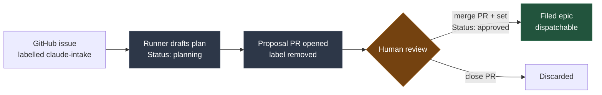
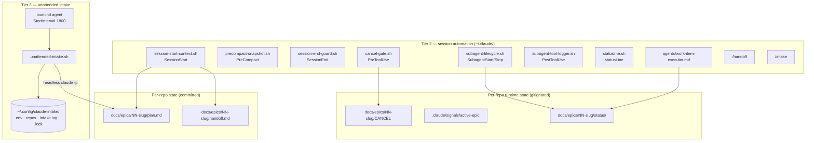
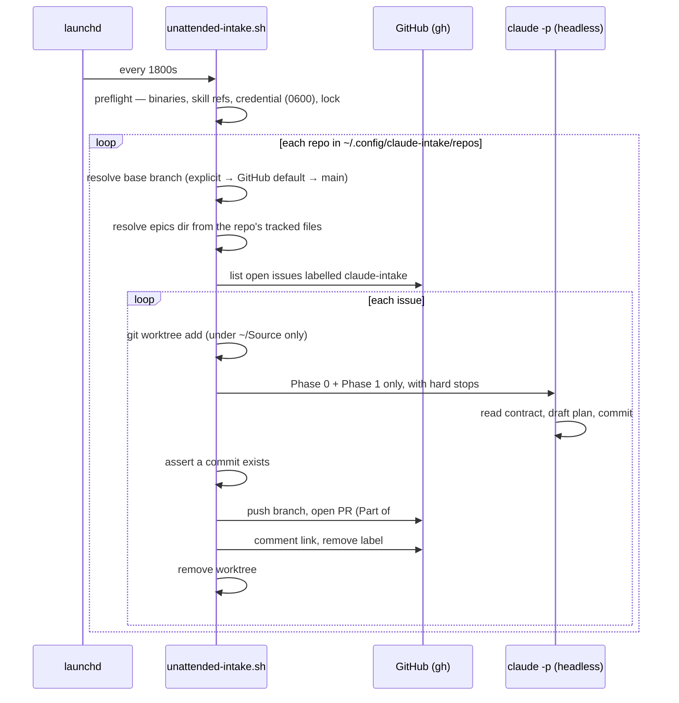

# dev-epic-workflow automation — architecture, install, and use

**Scope.** This describes the automation that ships with the `dev-epic-workflow` skill: the
session hooks and executor control plane that run inside every Claude Code session, and the
unattended intake runner that turns labelled GitHub issues into proposal pull requests while
nobody is watching.

**Status of this document.** Written 2026-08-20 against the working tree of `claude-skills`
at branch `fix/runner-contract-paths`. Everything below was read from the source files, not
recalled. Known gaps are called out in [Known gaps](#known-gaps) rather than smoothed over.

---

## 1. The mental model

The system has **three tiers**, and they are independent — each is useful without the ones
above it.

| Tier | What it is | Where it runs | Opt-in? |
|---|---|---|---|
| **1 — The process** | The workflow itself: plan → branch → commit → verify → close | In your head and in `docs/epics/` | It's the method |
| **2 — Session automation** | Hooks, the `work-item-executor` agent, `/handoff` and `/intake` | Inside every Claude Code session | `install.sh`, once per machine |
| **3 — Unattended intake** | A launchd agent polling GitHub for labelled issues | Background, on a 30-minute timer | Deliberately loaded, or not at all |

The single most important idea: **tier 3 never makes decisions.** It drafts a proposal and
stops. Approval is a human merging a PR and editing one line. Everything in the design of the
runner exists to make that boundary impossible to cross by accident.

### The approval boundary



A plan at `Status: planning` is **never dispatchable**, even sitting on the integration
branch. It is a draft that happens to be version-controlled. The session-start hook enforces
the distinction visually: `planning` epics list under *awaiting approval*, only `approved`
ones under *awaiting dispatch*.

---

## 2. Architecture

### 2.1 Component map



### 2.2 The two planes

**Session plane (tier 2)** is reactive. Hooks fire on Claude Code lifecycle events and do two
jobs: *inject truth at the start* (git state, the active handoff, the epic queue, the intake
config) and *preserve truth at the end* (snapshot before compaction, guard against ending a
session with uncommitted work). The executor control plane adds observability and a
deterministic stop for dispatched subagents.

**Intake plane (tier 3)** is scheduled. A launchd agent runs the runner every 30 minutes. The
runner is a single-pass bash script — it never daemonises, never loops, and holds one lock for
the whole run.

### 2.3 The unattended run, step by step



**The runner never touches the target checkout.** No `git switch`, no `git pull` in your
working copy — you may be mid-edit on another branch. It fetches, then creates an isolated
worktree from `origin/<base>`.

### 2.4 Where state lives

| State | Location | Committed? | Lifetime |
|---|---|---|---|
| Epic plan | `docs/epics/<NN>-<slug>/plan.md` | Yes | Permanent — the record |
| Session handoff | `docs/epics/<NN>-<slug>/handoff.md` | Yes | Overwritten each checkpoint; deleted at close |
| Executor status | `docs/epics/<NN>-<slug>/status/` | No (gitignored) | Per work item |
| Active-epic pointer | `.claude/signals/active-epic` | No (gitignored) | Rewritten at each dispatch |
| Cancel sentinel | `docs/epics/<NN>-<slug>/CANCEL` | No (gitignored) | Until honoured |
| Runner credential | `~/.config/claude-intake/env` (mode 0600) | **Never** | Until rotated |
| Runner repo list | `~/.config/claude-intake/repos` | No — outside any repo | Edited by hand |
| Runner log | `~/.config/claude-intake/intake.log` | No | Appended forever |

The runner's config lives **outside any repo** deliberately: it is per-machine, and the
credential must never be in a repo or in a world-readable launchd plist.

### 2.5 The safety model

This is the part worth designing prominently — it is what makes an unattended agent
acceptable to run.

**Hard stops, restated in the prompt itself** (the model is the thing being constrained):

- never approves — plans are written at `Status: planning`
- never dispatches an executor or subagent
- never writes code outside the proposal folder
- never merges, never closes an issue
- never pushes or opens a PR — the runner does that, so the agent cannot

**Mechanical guards, each with its own exit code:**

| Guard | Behaviour | Exit |
|---|---|---|
| Credential file missing | Refuses to run | `3` |
| Credential looser than `0600` | Refuses to run | `3` |
| `CLAUDE_CODE_OAUTH_TOKEN` empty | Refuses to run | `3` |
| `git` / `gh` / `claude` not executable | Refuses to run | `1` |
| Skill references not where `SKILL_DIR` says | Refuses to run | `1` |
| Another run holds the lock | Exits quietly | `2` |
| One or more issues failed | Completes the rest, reports | `4` |
| Normal, including "nothing to do" | — | `0` |

**Other invariants:**

- **Token never in argv.** Sourced into the environment; `ps` is world-readable.
- **Redaction is unconditional.** Anything token-shaped is scrubbed before it reaches the
  log, whether it came from the runner or from a subprocess's error text.
- **`~/Source` is the only directory the runner may create in.** A worktree path that would
  escape the declared root is refused.
- **`--dry-run` mutates nothing, anywhere** — no worktrees, no branches, no PRs, no labels.
- **Deterministic failures don't retry forever.** A failed issue gets a comment explaining
  why and loses its label; re-apply the label to try again.

---

## 3. Install

### 3.1 Prerequisites

- macOS (the launchd agent is macOS-specific; tiers 1–2 are portable)
- `git`, and `gh` authenticated (`gh auth status`)
- Claude Code CLI on `PATH`
- `python3` (used by `install.sh` to merge settings JSON)

### 3.2 Tier 2 — session automation

Run **once per machine**:

```bash
bash ~/.claude/skills/dev-epic-workflow/assets/claude-config/install.sh --user
```

This installs into `~/.claude/`, so it applies to every repo and worktree on the machine with
nothing committed into any repo — the right choice for client repos.

> **Note the default.** Running `install.sh` with no arguments installs in **repo mode**, into
> the current repo's `.claude/`. `--user` is the recommended mode and must be passed
> explicitly.

**Repo mode** — for cloud sessions, teammates, or self-contained repos:

```bash
bash <skill-path>/assets/claude-config/install.sh --commit
```

Repo mode also appends four runtime-state lines to `.gitignore`:

```
.claude/handoff-autosnapshot.md
.claude/signals/
docs/epics/*/status/
docs/epics/*/CANCEL
```

**Never install both modes for the same repo** — hooks append, so both would fire and
duplicate the session-start injection.

What lands, in either mode:

| Artifact | Destination |
|---|---|
| 7 hook scripts | `<target>/hooks/` (made executable) |
| `/handoff`, `/intake` | `<target>/commands/` |
| `work-item-executor` agent | `<target>/agents/` |
| Hook wiring + statusline | merged into `<target>/settings.json` |

The settings merge is **non-clobbering and idempotent**: an existing `statusLine` is left
alone, and hook groups already wired are skipped. Re-running the installer is how updated
scripts roll out.

Takes effect on the **next** session, not the current one.

### 3.3 Tier 3 — unattended intake

Four steps, in order. Nothing here is done by `install.sh` — scheduling is a per-machine
choice, and this agent runs an agent.

**Step 1 — the credential.** A subscription-backed OAuth token, not an API key, not the
Keychain:

```bash
claude setup-token
```

```bash
mkdir -p ~/.config/claude-intake && printf 'CLAUDE_CODE_OAUTH_TOKEN=<token>\n' > ~/.config/claude-intake/env && chmod 600 ~/.config/claude-intake/env
```

The runner refuses to start (`rc=3`) if this file is missing, empty, or looser than `0600`.

**Step 2 — the repo list.** One absolute path per line. `#` comments and blank lines are
ignored. An optional `|<base-branch>` names the **integration** branch, which is not
necessarily the GitHub default:

```
# Repos the unattended intake poller watches.
/Users/you/Source/claude-skills
/Users/you/Source/Oracle-Simple-Convert|dev
```

Written to `~/.config/claude-intake/repos`. A missing or empty list falls back to a single
repo (`INTAKE_REPO_DIR`, default `~/Source/claude-skills`). A listed path that isn't a git
repo, has no GitHub remote, or whose base branch doesn't exist on `origin` is **logged and
skipped without aborting the run**.

**Step 3 — the label.** The runner creates `claude-intake` in a repo if it's missing, so this
is usually automatic.

**Step 4 — the schedule.**

```bash
cp <skill>/assets/claude-config/launchd/com.jonathanstevenson.unattended-intake.plist ~/Library/LaunchAgents/
```

Edit `ProgramArguments` to point at your checkout, then:

```bash
launchctl load ~/Library/LaunchAgents/com.jonathanstevenson.unattended-intake.plist
```

Key plist facts:

| Key | Value | Why |
|---|---|---|
| `StartInterval` | `1800` (30 min) | Raise rather than lower — each run that finds an issue spends subscription usage |
| `RunAtLoad` | `false` | Loading it should not immediately spend usage |
| `ProcessType` | `Background` | Lower scheduling priority |
| `StandardOutPath` | `~/.config/claude-intake/launchd.out.log` | Per-run summary |
| `PATH` | minimal + `/opt/homebrew/bin` | Safety net; the runner resolves binaries absolutely anyway |

**The credential is not in the plist and must never be** — files in `~/Library/LaunchAgents/`
are world-readable.

**Unload:**

```bash
launchctl unload ~/Library/LaunchAgents/com.jonathanstevenson.unattended-intake.plist
```

> Unloading stops future polls. It does **not** kill a run already in flight — that run's
> processes must be terminated separately, after which a stale `~/.config/claude-intake/.lock`
> and an orphaned worktree under `~/Source/<repo>-proposed-*` may need clearing.

The agent runs only while the Mac is awake and you are logged in. Sleep pauses a drain until
wake. That is accepted — the interactive `/intake` path always works regardless.

### 3.4 Verifying the install

```bash
<skill>/assets/claude-config/bin/unattended-intake.sh --dry-run
```

A healthy dry run reports every configured repo, its resolved base branch, the issues it
would process, and the exact plan path it would write — and mutates nothing. Confirm
afterwards that no worktree was created and no branch changed.

---

## 4. How to use it

### 4.1 Choosing a path — the distinction that matters

**The unattended runner cannot resolve anything.** By design it runs Phase 0 and Phase 1,
opens a proposal PR, and stops. It never approves, never dispatches, never writes code. Even
at a one-minute poll interval it would still hand you a draft and wait.

So the two paths are not fast-vs-slow versions of the same thing:

| | Manual (`/intake`) | Unattended (label) |
|---|---|---|
| Latency to start | Immediate | Up to one poll interval (30 min) |
| How far it goes | Phase 0 → Phase 1 → **approval → dispatch → merged code** | Phase 0 → Phase 1 → **stops at a proposal PR** |
| Approval | In the moment, with you present | A separate PR review later |
| Best for | Anything that must land today | Bulk-drafting a backlog while you are away |
| Round trips | One sitting | Draft now, review later, dispatch later |

They compose well: let the runner fill the queue overnight, clear it with `/intake` at the
keyboard. **When something has to be resolved today, skip the label entirely** — the
unattended path adds both waiting and a review round trip.

### 4.2 The manual loop (interactive)

`/intake` is installed at `~/.claude/commands/intake.md` by the user-level install, so it works
in **any repo on the machine** — no per-repo setup. Start a session in the target repo:

```bash
claude
```

| You type | What happens |
|---|---|
| `/intake #123` | **Pickup** — fetches the issue with comments, grounds against the repo, drafts the plan, you approve, it dispatches |
| `/intake bug: mapper hangs on empty upload` | **Report** — files the tracker item *first*, confirms the ref in one line, then picks it up |
| `/intake` | **Backlog** — lists open items with a recommended order by dependency and blast radius, and asks which to take |
| `/handoff` | Checkpoint before `/clear` or end of day |
| *(just describe it)* | Same as `/intake <description>` — natural language is the normal path |

**You never have to type `/intake` before describing a problem.** The command exists so the
full ritual runs deterministically, not as a gate in front of you.

The command detects the tracker itself — `git remote get-url origin` resolves GitHub (`gh`) or
Azure DevOps (`az boards`), and a `Tracker:` line in the repo's `CLAUDE.md` wins over
detection. If authentication is missing it reports exactly what is missing and stops rather
than half-running intake.

### 4.3 Forcing an unattended run immediately

To make the poller draft *right now* instead of waiting for its interval — useful when you
want headless drafting without the 30-minute gap, but still only produces a proposal:

```bash
~/Source/claude-skills/Skills/dev-epic-workflow/assets/claude-config/bin/unattended-intake.sh
```

One issue only, label check bypassed:

```bash
~/Source/claude-skills/Skills/dev-epic-workflow/assets/claude-config/bin/unattended-intake.sh --issue 727 --force-issue
```

Two caveats:

- **One lock for the whole system.** If a scheduled run is already in flight, a manual run
  exits `rc=2` and does nothing. `/intake` is unaffected — the lock guards the poller, not
  the repo.
- **`launchctl load` does not trigger a run.** `RunAtLoad` is `false`, so loading the agent
  starts the clock rather than the work; the first scheduled run is one full interval later.

**Changing the interval** — edit `StartInterval` in
`~/Library/LaunchAgents/com.jonathanstevenson.unattended-intake.plist`, then unload and reload
the agent. `900` gives 15-minute pickup. Idle polls are nearly free (two `gh` calls when
nothing is labelled); the cost is entirely in drafting, so the interval trades pickup latency
against nothing much until an issue is actually labelled.

### 4.4 The unattended loop

1. **Label** an issue `claude-intake`.
2. **Wait** — up to 30 minutes for the next poll.
3. **Review** the proposal PR. The runner comments the link on the issue and removes the label.
4. **Approve** by merging the PR *and* editing `Status: planning` → `Status: approved`, and
   renaming `proposed-<issue>-<slug>/` to `<NN>-<slug>/` with the next epic number.
5. **Or discard** by closing the PR.

Approval is **two actions, not one**. Merging alone leaves a draft on the integration branch.

> **Numbering.** No epic number is claimed at draft time. Phase 1 assigns numbers **at
> approval**, so two issues labelled simultaneously produce two proposals that structurally
> cannot collide.

### 4.5 Operating it

```bash
tail -f ~/.config/claude-intake/intake.log
```

```bash
<skill>/bin/unattended-intake.sh --issue 730 --dry-run
```

**Command-line flags:**

| Flag | Effect |
|---|---|
| `--dry-run` | Report what would happen; mutate nothing |
| `--issue N` | Process only issue N (still needs the label) |
| `--force-issue` | With `--issue`, skip the label check |
| `--repo owner/name` | Override repo detection |
| `--once` | Accepted; single-pass is the only mode |
| `-h`, `--help` | Print the header |

**Environment overrides** — every path is overridable, which is what makes the guard battery
testable: `INTAKE_GIT`, `INTAKE_GH`, `INTAKE_CLAUDE`, `INTAKE_ENV_FILE`, `INTAKE_REPO_DIR`,
`INTAKE_REPO_LIST`, `INTAKE_LOG`, `INTAKE_LOCK`, `INTAKE_LABEL`, `INTAKE_WORKTREE_ROOT`,
`INTAKE_SKILL_DIR`.

### 4.6 Troubleshooting

| Symptom | Cause | Fix |
|---|---|---|
| Exits `3` immediately | Credential missing, empty, or not `0600` | `claude setup-token`; `chmod 600` the env file |
| Exits `2` every poll | Stale lock from a killed run | `rm -rf ~/.config/claude-intake/.lock` |
| Exits `1` at startup | A binary or skill reference isn't where expected | Read the FATAL line — it names the path and the fix |
| Nothing happens | Agent not loaded, or Mac asleep | `launchctl list \| grep unattended` |
| A repo is skipped | Not a git repo, no GitHub remote, or base branch absent on `origin` | Check the `skip:` line in the log |
| Orphaned `~/Source/<repo>-proposed-*` | A run was killed mid-issue | `git worktree remove --force`, then `git worktree prune` |
| An issue lost its label but has no PR | Deterministic failure | Read the failure comment on the issue; re-label to retry |

---

## 5. Design notes for the interactive document

Suggestions for whoever builds the interactive version — the concepts most worth making
clickable or animated:

1. **The approval boundary** is the story. An interactive diagram where the reader tries to
   push a `planning` plan into dispatch and *can't* would teach the system's core idea faster
   than any paragraph.
2. **The three tiers as progressive disclosure.** Most readers only need tier 1 + 2. Tier 3
   should be behind a deliberate "I want unattended runs" step, mirroring how it is
   deliberately loaded rather than installed.
3. **The guard table wants to be a live checklist** — a preflight simulator where toggling
   "credential is 0644" shows `rc=3` and the actual FATAL message.
4. **The sequence diagram in §2.3 is the install verification.** Pairing each step with the
   log line it produces would let a reader match their real output against the reference.
5. **Two-action approval is the most common misunderstanding.** Worth an explicit interactive
   beat: merge → still a draft → edit status → now dispatchable.
6. **Do not bury the "runner never touches your checkout" guarantee.** It is the fact that
   makes people comfortable leaving it loaded.
7. **Lead with the path chooser (§4.1), not the install.** The most common wrong turn is
   reaching for the label when the work has to land today. A two-question decision widget —
   *"does this need to be resolved now?"* / *"are you at the keyboard?"* — routes the reader
   to `/intake` or the label before they read anything else.

---

## Known gaps

Recorded so the design document does not present them as solved:

- **The PR body still hardcodes lowercase `docs/epics/`** in its rename-to-approve
  instruction. Repos using a different case (`DOCS/EPICS/`) get a PR whose instructions name
  a path that doesn't match the folder actually created. Cosmetic, not functional. Tracked as
  part of GH #34.
- **The runner and the desktop app use two separate Claude Code installs** on this machine —
  a bare Mach-O at `~/.local/share/claude/versions/<version>` for the runner, an app bundle
  under `~/Library/Application Support/Claude/claude-code/<version>/` for the desktop app.
  They are granted macOS privacy permissions separately, so consenting for one does not
  consent for the other.
- **Quality of unattended-drafted plans has not been independently reviewed.** The mechanism
  is verified; the drafting judgement is not.
- **No `caffeinate` wrapper.** A drain pauses when the Mac sleeps.
